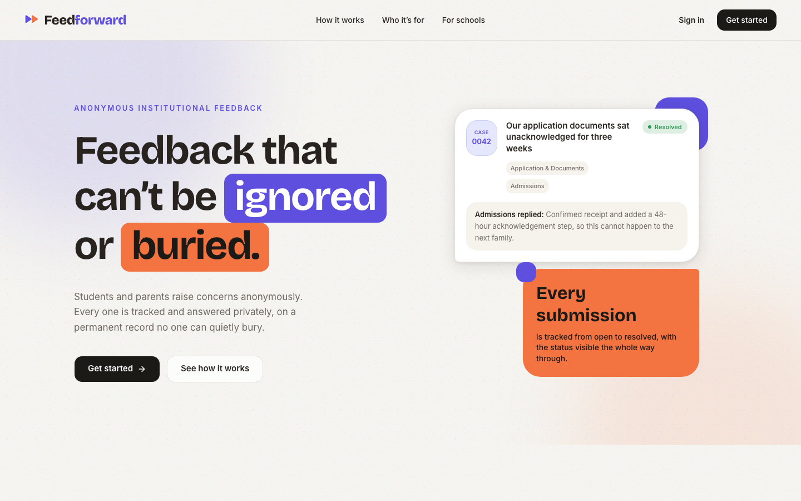
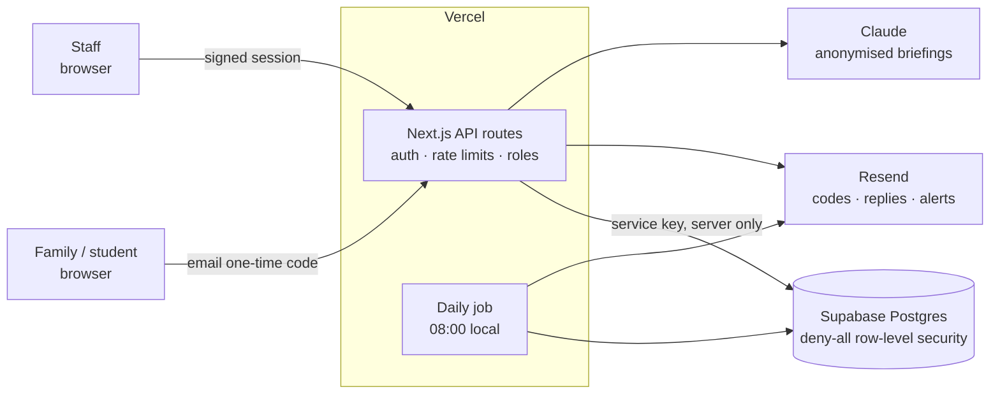

# Feedforward

**Feedback that can't be ignored or buried.**

**Live:** [app.feedforward.guru](https://app.feedforward.guru)

Feedforward is an anonymous feedback platform for schools and other institutions. Families
and students raise concerns anonymously, and staff claim, answer and close each one on a
permanent record that nobody can quietly bury. It's in a live pilot with a school admissions
team.

> This is a showcase repository. Feedforward is a commercial product, so the source code is
> private. This page covers what it does, how it's built and how it ships. For a code
> walkthrough, get in touch.

---

## The problem

Most institutional feedback goes into a form, a survey or someone's inbox, and then nothing
visible happens. The people giving feedback learn that it goes nowhere, so they stop giving
it, or they take it somewhere public instead. The people receiving it never get a clean
picture of what's actually going wrong.

Feedforward closes the loop. Every concern becomes a tracked case with an owner, a reply
deadline and a history, and the person who raised it gets an answer while staying
anonymous.

---

## How a case works

1. **A family raises a concern.** They sign in with an email one-time code and write it up.
   Staff never see who they are, only a stable codename, so a history can be followed
   without identifying anyone.
2. **Someone claims it.** A staff member claims the case or is assigned it, and colleagues
   can be added as collaborators.
3. **Private back-and-forth.** Replies go to the family by email and stay in the thread.
   The family can answer back, which puts the case back in the staff queue.
4. **It closes, on the record.** Either side closes the case, or it auto-closes after a
   quiet period. Nothing is ever hard-deleted. Removing spam or abuse is a soft delete that
   keeps the text, the reason and who removed it.

### Built for the people answering

- **Reply targets by urgency:** 24h for high, 48h for medium, 72h for low. Anything overdue
  is flagged in the queue and in the owner's digest.
- **Routing:** a high-urgency concern pings the staff covering that category immediately.
  Low and medium concerns wait for the morning digest, so nobody gets paged for small things.
- **Daily digest:** each staff member gets one email at 8am local time, and only if they
  have something to act on.
- **Monthly report:** an Excel workbook (summary, cases, backlog, conversation and activity
  logs, median first-reply time, on-time rate) is emailed to leadership on the 1st.
  Families appear only as codenames.
- **AI briefing:** Claude turns a month of feedback into a prioritised action plan, written
  so it can't be traced back to any one family.
- **Roles:** owners manage staff accounts, admins work cases, and faculty see only feedback
  about their own classes.

---

## Architecture

**The browser never touches the database.** Every read and write goes through server-side
routes that check the session and the user's role. The database has row-level security
switched on with no policies, so the public API keys can't reach anything, and a leaked
client bundle gives away nothing useful.

**No personal data where it isn't needed.** Identities are stored as salted hashes, and
staff only ever see codenames. A database breach wouldn't expose who said what.

**Everything is auditable.** Every case carries an append-only event log: created, replied,
claimed, assigned, reopened, closed, auto-closed, removed, each with who and when.

**White-label by configuration.** Each institution's copy, colours and email access policy
live in one brand config. A new school is a config change, not a code change, and each
school gets its own entry link and school code.

### Stack

| | |
|---|---|
| App | Next.js 16 (App Router), React 19 |
| UI | Tailwind v4, shadcn/ui on Base UI, Framer Motion, Recharts |
| Data | Supabase (Postgres) |
| Email | Resend |
| AI | Anthropic Claude |
| Reports | ExcelJS |
| Hosting | Vercel, custom domain |

---

## How it ships

- **Every push deploys.** Vercel builds straight from GitHub. `main` is production and
  other branches get their own preview URL, so a redesign is reviewed on a live preview
  before it's merged.
- **Schema changes go first.** Database migrations are versioned SQL files, run against
  production before the code that depends on them is deployed.
- **One scheduled job.** A single Vercel cron runs every morning to auto-close stale
  threads, send digests and, on the 1st, send the monthly report. It's idempotent, has a
  dry-run mode and can be triggered by hand for a single month.
- **Secrets stay in the environment.** Keys live only in Vercel environment variables,
  never in the repo. Development-only shortcuts refuse to run in production.

---

## Status

- Live and in a pilot with a school admissions team.
- Open to other schools and institutions. Contact: [GitHub @iqnco](https://github.com/iqnco)

---

© 2026 Feedforward. All rights reserved. Screenshots and text in this repository may not be
reused without permission.
